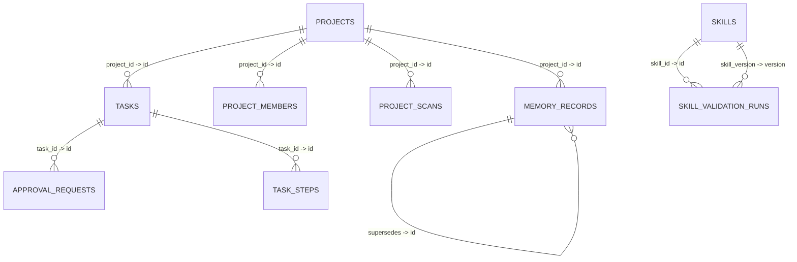

# Database Schema

> Generated by `scripts/gen_reference_docs.py` from the migrations. Do not edit by hand.

Engine: SQLite (WAL, `synchronous=FULL`, foreign keys on). Schema version: **3** (3 migrations). Tables: **14**.

## Migrations

| Version | Name |
|---|---|
| 1 | `initial_core_schema` |
| 2 | `project_members_and_token_expiry` |
| 3 | `agent_runs` |

## Relationships

## `agent_runs`

One row per agent invocation (including denied ones) with input/output digests.

| Column | Type | Not null | PK | References |
|---|---|---|---|---|
| `id` | TEXT |  | 1 |  |
| `task_id` | TEXT |  |  |  |
| `project_id` | TEXT |  |  |  |
| `agent` | TEXT | yes |  |  |
| `operation` | TEXT | yes |  |  |
| `actions_json` | TEXT | yes |  |  |
| `status` | TEXT | yes |  |  |
| `started_at` | TEXT | yes |  |  |
| `finished_at` | TEXT |  |  |  |
| `input_digest` | TEXT | yes |  |  |
| `output_digest` | TEXT |  |  |  |
| `error` | TEXT |  |  |  |

Indexes: `ix_agent_runs_agent`, `ix_agent_runs_task`

## `api_tokens`

Only SHA-256 hashes of tokens are stored; every token expires.

| Column | Type | Not null | PK | References |
|---|---|---|---|---|
| `id` | TEXT |  | 1 |  |
| `token_hash` | TEXT | yes |  |  |
| `actor_id` | TEXT | yes |  |  |
| `role` | TEXT | yes |  |  |
| `created_at` | TEXT | yes |  |  |
| `revoked_at` | TEXT |  |  |  |
| `expires_at` | TEXT |  |  |  |

## `approval_requests`

Bound to (action, target, operation_digest); single-use; expires; revoked on cancel.

| Column | Type | Not null | PK | References |
|---|---|---|---|---|
| `id` | TEXT |  | 1 |  |
| `action` | TEXT | yes |  |  |
| `target` | TEXT | yes |  |  |
| `operation_digest` | TEXT | yes |  |  |
| `summary` | TEXT | yes |  |  |
| `requested_by` | TEXT | yes |  |  |
| `task_id` | TEXT |  |  | `tasks.id` |
| `created_at` | TEXT | yes |  |  |
| `expires_at` | TEXT | yes |  |  |
| `status` | TEXT | yes |  |  |
| `decided_by` | TEXT |  |  |  |
| `decided_at` | TEXT |  |  |  |
| `decision_reason` | TEXT |  |  |  |
| `consumed_at` | TEXT |  |  |  |

Indexes: `ix_approvals_status`

## `audit_events`

Append-only; HMAC hash chain (ADR-0004). Never updated or deleted by the platform.

| Column | Type | Not null | PK | References |
|---|---|---|---|---|
| `seq` | INTEGER |  | 1 |  |
| `id` | TEXT | yes |  |  |
| `created_at` | TEXT | yes |  |  |
| `actor` | TEXT | yes |  |  |
| `action` | TEXT | yes |  |  |
| `target` | TEXT | yes |  |  |
| `outcome` | TEXT | yes |  |  |
| `details_json` | TEXT | yes |  |  |
| `prev_hash` | TEXT | yes |  |  |
| `hash` | TEXT | yes |  |  |

## `evidence_records`

Append-only; each row content-hashed and anchored in the audit chain.

| Column | Type | Not null | PK | References |
|---|---|---|---|---|
| `id` | TEXT |  | 1 |  |
| `task_id` | TEXT |  |  |  |
| `action` | TEXT | yes |  |  |
| `actor` | TEXT | yes |  |  |
| `target` | TEXT | yes |  |  |
| `created_at` | TEXT | yes |  |  |
| `outcome` | TEXT | yes |  |  |
| `body_json` | TEXT | yes |  |  |
| `content_hash` | TEXT | yes |  |  |

Indexes: `ix_evidence_task`

## `memory_records`

Versioned; verified rows are superseded, never overwritten silently.

| Column | Type | Not null | PK | References |
|---|---|---|---|---|
| `id` | TEXT |  | 1 |  |
| `project_id` | TEXT |  |  | `projects.id` |
| `category` | TEXT | yes |  |  |
| `subject` | TEXT | yes |  |  |
| `key` | TEXT | yes |  |  |
| `value_json` | TEXT | yes |  |  |
| `status` | TEXT | yes |  |  |
| `confidence` | REAL | yes |  |  |
| `source` | TEXT | yes |  |  |
| `evidence_ids_json` | TEXT | yes |  |  |
| `validity_json` | TEXT | yes |  |  |
| `version` | INTEGER | yes |  |  |
| `supersedes` | TEXT |  |  | `memory_records.id` |
| `contradicts_json` | TEXT | yes |  |  |
| `created_at` | TEXT | yes |  |  |
| `validated_at` | TEXT |  |  |  |
| `revalidate_after` | TEXT |  |  |  |

Indexes: `ix_memory_category`, `ix_memory_lookup`

## `project_members`

Per-project roles; a token role is the ceiling (ADR-0007).

| Column | Type | Not null | PK | References |
|---|---|---|---|---|
| `project_id` | TEXT | yes | 1 | `projects.id` |
| `actor_ref` | TEXT | yes | 2 |  |
| `role` | TEXT | yes |  |  |
| `granted_by` | TEXT | yes |  |  |
| `granted_at` | TEXT | yes |  |  |

Indexes: `ix_members_actor`

## `project_scans`

| Column | Type | Not null | PK | References |
|---|---|---|---|---|
| `id` | TEXT |  | 1 |  |
| `project_id` | TEXT | yes |  | `projects.id` |
| `created_at` | TEXT | yes |  |  |
| `tree_hash` | TEXT | yes |  |  |
| `snapshot_json` | TEXT | yes |  |  |

Indexes: `ix_scans_project_time`

## `projects`

| Column | Type | Not null | PK | References |
|---|---|---|---|---|
| `id` | TEXT |  | 1 |  |
| `name` | TEXT | yes |  |  |
| `root_path` | TEXT | yes |  |  |
| `created_at` | TEXT | yes |  |  |
| `created_by` | TEXT | yes |  |  |

## `schema_migrations`

| Column | Type | Not null | PK | References |
|---|---|---|---|---|
| `version` | INTEGER |  | 1 |  |
| `name` | TEXT | yes |  |  |
| `applied_at` | TEXT | yes |  |  |

## `skill_validation_runs`

| Column | Type | Not null | PK | References |
|---|---|---|---|---|
| `id` | TEXT |  | 1 |  |
| `skill_id` | TEXT | yes |  | `skills.id` |
| `skill_version` | INTEGER | yes |  | `skills.version` |
| `created_at` | TEXT | yes |  |  |
| `passed` | INTEGER | yes |  |  |
| `results_json` | TEXT | yes |  |  |
| `content_hash` | TEXT | yes |  |  |

## `skills`

Primary key (id, version); a changed spec is a new version starting at PROPOSED.

| Column | Type | Not null | PK | References |
|---|---|---|---|---|
| `id` | TEXT | yes | 1 |  |
| `version` | INTEGER | yes | 2 |  |
| `status` | TEXT | yes |  |  |
| `spec_json` | TEXT | yes |  |  |
| `content_hash` | TEXT | yes |  |  |
| `created_at` | TEXT | yes |  |  |
| `created_by` | TEXT | yes |  |  |
| `updated_at` | TEXT | yes |  |  |

Indexes: `ix_skills_status`

## `task_steps`

One row per (task, step); completed steps are never re-run on resume.

| Column | Type | Not null | PK | References |
|---|---|---|---|---|
| `task_id` | TEXT | yes | 1 | `tasks.id` |
| `name` | TEXT | yes | 2 |  |
| `status` | TEXT | yes |  |  |
| `attempt` | INTEGER | yes |  |  |
| `started_at` | TEXT |  |  |  |
| `finished_at` | TEXT |  |  |  |
| `output_json` | TEXT |  |  |  |
| `error` | TEXT |  |  |  |

## `tasks`

Persistent ORION task state; lease columns prevent two workers running one task.

| Column | Type | Not null | PK | References |
|---|---|---|---|---|
| `id` | TEXT |  | 1 |  |
| `project_id` | TEXT | yes |  | `projects.id` |
| `kind` | TEXT | yes |  |  |
| `status` | TEXT | yes |  |  |
| `created_by` | TEXT | yes |  |  |
| `created_at` | TEXT | yes |  |  |
| `updated_at` | TEXT | yes |  |  |
| `params_json` | TEXT | yes |  |  |
| `current_step` | TEXT |  |  |  |
| `error` | TEXT |  |  |  |
| `lease_owner` | TEXT |  |  |  |
| `lease_expires_at` | TEXT |  |  |  |

Indexes: `ix_tasks_status`

## Retention

No automatic deletion is implemented. Audit, evidence and agent-run rows are append-only by design;
deleting a project cascades to its scans, memory, tasks and memberships (foreign keys).
A retention policy for long-running installations is **not implemented** (see FEATURE_STATUS).
